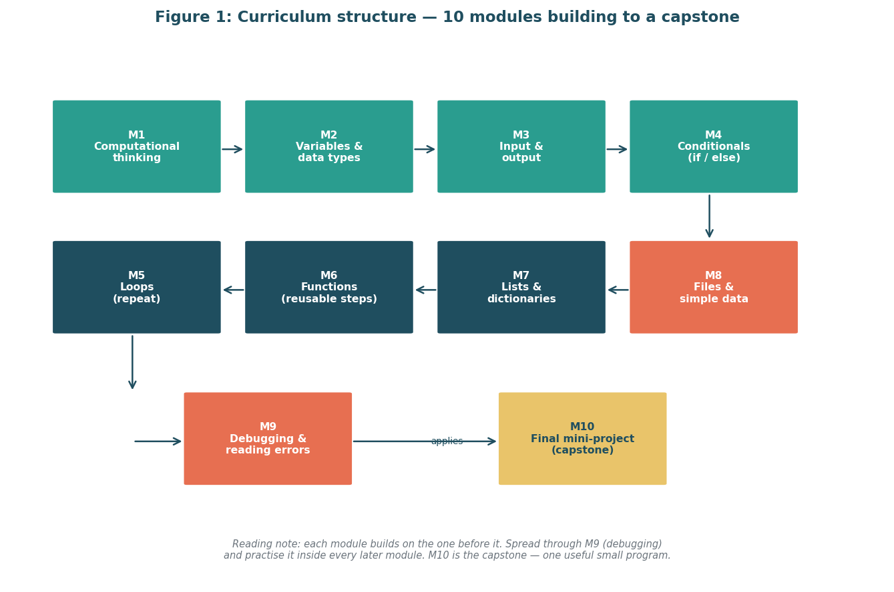

<a id="readme-top"></a>

<div align="center">

[![Status][status-shield]][repo-url]
[![Python][python-shield]][python-url]
[![Deliverable][docx-shield]][report-url]
[![License][license-shield]](#license)

<br />

<a href="weeks/week1/figures/fig2_learner_journey.png">
  
</a>

# Virtual Programming Fundamentals Internship

**A project plan and scope definition for a 30-hour programming module, written for people who have never written a line of code.**

[View the Week 1 report](weeks/week1/reports/Project_Plan_Scope_Definition_Week1.docx) &nbsp;·&nbsp;
[Read the Week 1 docs](weeks/week1/README.md) &middot;
[View the Week 2 report](weeks/week2/reports/Curriculum_Lesson_Plans_Week2.docx) &nbsp;·&nbsp;
[Report a bug](https://github.com/mishtiiikrishnaa/virtualinternship2/issues/new?labels=bug&template=bug-report---.md) &nbsp;·&nbsp;
[Request a feature](https://github.com/mishtiiikrishnaa/virtualinternship2/issues/new?labels=enhancement&template=feature-request---.md)

</div>

<details>
  <summary>Table of Contents</summary>

1. [About The Project](#about-the-project)
2. [The Module at a Glance](#the-module-at-a-glance)
3. [Progress](#progress)
4. [Built With](#built-with)
5. [Getting Started](#getting-started)
6. [Usage](#usage)
7. [Repository Layout](#repository-layout)
8. [Roadmap](#roadmap)
9. [Known Limitations](#known-limitations)
10. [Contributing](#contributing)
11. [License](#license)
12. [Acknowledgments](#acknowledgments)

</details>

---

## About The Project

[](weeks/week1/figures/fig1_curriculum_structure.png)

This repository is the home for the four-week **Virtual Programming Fundamentals Internship** in Ahmedabad, run through YuvaIntern (2 to 30 November 2026). Each week is one task of roughly 30 to 35 hours, submitted as a Word document with this repository linked as the project.

Across the four weeks, the internship designs a programming fundamentals module for **non-programmers**, meaning adults or students who have never coded:

1. **Week 1:** plan it and define its scope
2. **Week 2:** develop the content and build the curriculum
3. **Week 3:** design a practical, interactive module
4. **Week 4:** reflect, evaluate, and plan what comes next

Each week builds on the one before it. Every week lives in its own folder, so nothing from a later week overwrites an earlier one.

Week 1 is done. Every piece of jargon in the plan is explained, and the whole report is generated from scripts rather than edited by hand, so the document, its figures and its tests always agree with each other.

<p align="right">(<a href="#readme-top">back to top</a>)</p>

## The Module at a Glance

The plan describes a module that:

* teaches **Python in the browser, with no installs**
* runs for **10 modules and 30 teaching hours**
* moves from thinking in steps, to choosing and repeating, to organising data and files, to reading errors, and ends with a **mini-project**
* teaches through **worked examples, Parsons problems, pair work, and predict-run-modify tasks**
* assesses with **short quizzes, exit tickets, small exercises, and a capstone rubric**

| Modules | What learners do                                |
|:-------:|-------------------------------------------------|
| 1 - 3   | Think in steps                                  |
| 4 - 5   | Choose and repeat                               |
| 6       | Group steps together                            |
| 7       | Organise data                                   |
| 8       | Use files                                       |
| 9       | Read errors                                     |
| 10      | Build a mini-project (capstone)                 |

<p align="right">(<a href="#readme-top">back to top</a>)</p>

## Progress

| Week | Task                                       | Deliverable (Word document)                                   | Status          |
|:----:|--------------------------------------------|---------------------------------------------------------------|-----------------|
| 1    | Project Planning and Scope Definition      | Project plan and scope definition                             | Ready to submit |
| 2    | Content Development and Curriculum Building | Curriculum with lesson plans, topics and learning activities  | Not started     |
| 3    | Practical Application and Interactive Module Design | Interactive module with activity steps, delivery notes and rubrics | Not started |
| 4    | Reflection, Evaluation, and Future Planning | Evaluation, personal reflection and future-planning proposal  | Not started     |

**Week 1 deliverable:** [`Project_Plan_Scope_Definition_Week1.docx`](weeks/week1/reports/Project_Plan_Scope_Definition_Week1.docx). It has a live table of contents, tables, and six diagrams, with a PDF preview alongside it.

### What the Week 1 brief asked for, and where to find it

| The brief asked for                                              | Where it is                                                        |
|------------------------------------------------------------------|--------------------------------------------------------------------|
| A clear table of contents                                        | Start of the `.docx` (a live Word field)                           |
| Diagrams or flowcharts of the curriculum structure               | Six figures in the report, also in `weeks/week1/figures/`          |
| A timeline with milestones and deadlines                         | Section 9 of the report (all dates labelled as planned)            |
| Resource requirements                                            | The resource table in the report (120 planned hours)               |
| Research on public materials for teaching non-programmers        | `weeks/week1/docs/research_register.md`                            |
| Target audience, teaching methods and assessment techniques      | Summarised in [The Module at a Glance](#the-module-at-a-glance)    |

<p align="right">(<a href="#readme-top">back to top</a>)</p>

## Built With

* [![Python][python-built-shield]][python-url]
* [![python-docx][python-docx-shield]][python-docx-url]
* [![matplotlib][matplotlib-shield]][matplotlib-url]
* [![pytest][pytest-shield]][pytest-url]
* [![LibreOffice][libreoffice-shield]][libreoffice-url]

`python-docx` builds the report, `matplotlib` draws the six figures, `pytest` validates the finished `.docx`, and LibreOffice (optional) produces the PDF preview.

<p align="right">(<a href="#readme-top">back to top</a>)</p>

## Getting Started

You only need this if you want to **rebuild** the report. To just read it, jump to [Usage](#usage).

### Prerequisites

* Python 3.10 or newer
  ```sh
  python3 --version
  ```
* pip
  ```sh
  pip3 --version
  ```
* git
  ```sh
  git --version
  ```
* LibreOffice (optional, only for the PDF preview)
  ```sh
  soffice --version
  ```

### Installation

1. Clone the repo
   ```sh
   git clone https://github.com/mishtiiikrishnaa/virtualinternship2.git
   cd virtualinternship2
   ```
2. Install the Python dependencies
   ```sh
   pip install -r weeks/week1/requirements.txt
   ```
3. Build the figures and the report
   ```sh
   make week1
   ```
4. Run the checks
   ```sh
   make check
   ```

<p align="right">(<a href="#readme-top">back to top</a>)</p>

## Usage

**Just want to read it?**

* Open [`Project_Plan_Scope_Definition_Week1.docx`](weeks/week1/reports/Project_Plan_Scope_Definition_Week1.docx) in Microsoft Word. The table of contents at the start is a live field, so if page numbers look off, right-click it and choose **Update Field**.
* Or open the PDF preview in the same `reports/` folder for a quick look at the figures and tables without Word.

**Want to see the thinking behind it?**

| File (in `weeks/week1/docs/`) | What it holds                      |
|-------------------------------|------------------------------------|
| `research_register.md`        | The research notes behind the plan |
| `assumptions_and_decisions.md`| Assumptions made and why           |
| `submission_text.txt`         | The 275-word submission text       |

**Want to rebuild it?** Run `make week1` to regenerate the figures and the `.docx`, then `make check` to run the tests.

For a full walkthrough of what each module covers, see the [Week 1 README](weeks/week1/README.md).

<p align="right">(<a href="#readme-top">back to top</a>)</p>

## Repository Layout

```text
virtualinternship2/
├── README.md
├── Makefile
├── .gitignore
└── weeks/
    └── week1/
        ├── README.md
        ├── requirements.txt
        ├── docs/        research register, assumptions and decisions, submission text
        ├── figures/     six PNG diagrams
        ├── src/         make_figures.py, build_docx.py
        ├── reports/     the .docx and its PDF preview
        └── tests/       test_docx.py (pytest)
```

Weeks 2 to 4 will each get their own `weeks/weekN/` folder as they are completed.

<p align="right">(<a href="#readme-top">back to top</a>)</p>

## Roadmap

- [x] **Week 1:** Project planning and scope definition
    - Keep dates honest: planned baseline is 5 November 2026, and every Section 9 date is labelled as planned
    - Keep the `.docx` under 2 MB
- [ ] **Week 2:** Content Development and Curriculum Building
- [ ] **Week 3:** Practical Application and Interactive Module Design
- [ ] **Week 4:** Reflection, Evaluation, and Future Planning

See the [open issues](https://github.com/mishtiiikrishnaa/virtualinternship2/issues) for proposed features and known issues.

<p align="right">(<a href="#readme-top">back to top</a>)</p>

## Known Limitations

* **Dates are planned, not done.** Section 9 of the report uses a planned baseline of 5 November 2026, the first working day after the report date. It skips weekends and the 25 November 2026 holiday.
* **References are public sources found on 4 November 2026.** Where only an abstract was available, the entry is marked to check before citing.
* **Effort is a planning figure.** The 120 planned hours match the resource table and are not a quote.
* **Page numbers in the `.docx` table of contents need a refresh.** It is a live Word field, so open the file in Word and choose *Update Field*.

<p align="right">(<a href="#readme-top">back to top</a>)</p>

## Contributing

This is a solo internship repository, so it is not open to contributions in the usual sense. If you spot a mistake or have a suggestion, please [open an issue](https://github.com/mishtiiikrishnaa/virtualinternship2/issues) with the `enhancement` label.

<p align="right">(<a href="#readme-top">back to top</a>)</p>

## License

No license file is included. This repository is for internship submission and review only. Please ask before reusing the text or figures.

<p align="right">(<a href="#readme-top">back to top</a>)</p>

## Acknowledgments

* [Best-README-Template](https://github.com/othneildrew/Best-README-Template) by othneildrew, for the README structure
* [Harvard CS50x](https://cs50.harvard.edu/x/), [Python for Everybody](https://www.py4e.com/), [Automate the Boring Stuff with Python](https://automatetheboringstuff.com/2e/) and [Code.org](https://code.org/en-US/curriculum/computer-science-fundamentals), for public beginner course structures
* [MIT Teaching and Learning Lab](https://tll.mit.edu/teaching-resources/how-people-learn/worked-examples/) and the [Raspberry Pi Foundation](https://www.raspberrypi.org/blog/supporting-learners-with-programming-tasks-through-ai-generated-parsons-problems/), for worked examples and Parsons problems
* [Shields.io](https://shields.io), for the badges
* [Choose an Open Source License](https://choosealicense.com)


<p align="right">(<a href="#readme-top">back to top</a>)</p>

<!-- LINKS -->
[repo-url]: https://github.com/mishtiiikrishnaa/virtualinternship2
[report-url]: weeks/week1/reports/Project_Plan_Scope_Definition_Week1.docx
[status-shield]: https://img.shields.io/badge/status-week%201%20of%204-green.svg?style=for-the-badge
[python-shield]: https://img.shields.io/badge/python-3.10+-blue.svg?style=for-the-badge
[docx-shield]: https://img.shields.io/badge/deliverable-docx-orange.svg?style=for-the-badge
[license-shield]: https://img.shields.io/badge/license-none-red.svg?style=for-the-badge
[python-built-shield]: https://img.shields.io/badge/python-3776AB?style=for-the-badge&logo=python&logoColor=white
[python-url]: https://www.python.org/
[python-docx-shield]: https://img.shields.io/badge/python--docx-4B0082?style=for-the-badge
[python-docx-url]: https://python-docx.readthedocs.io/
[matplotlib-shield]: https://img.shields.io/badge/matplotlib-11557c?style=for-the-badge
[matplotlib-url]: https://matplotlib.org/
[pytest-shield]: https://img.shields.io/badge/pytest-0A9EDC?style=for-the-badge&logo=pytest&logoColor=white
[pytest-url]: https://docs.pytest.org/
[libreoffice-shield]: https://img.shields.io/badge/libreoffice-18A303?style=for-the-badge&logo=libreoffice&logoColor=white
[libreoffice-url]: https://www.libreoffice.org/
