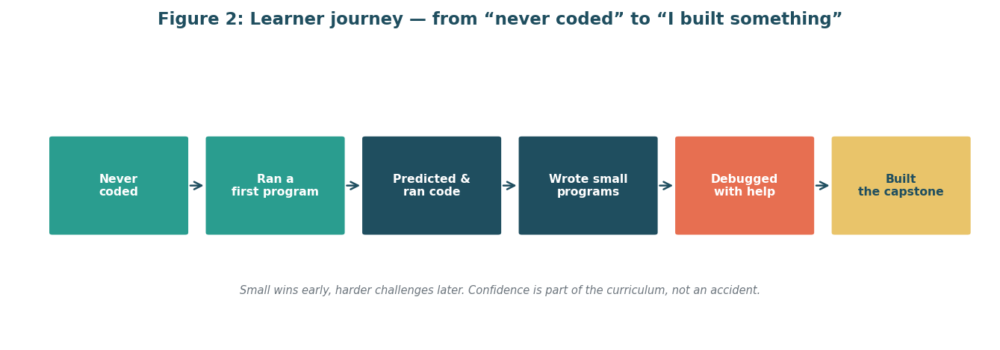

<a id="readme-top"></a>

<!-- PROJECT HEADER -->
<br />
<div align="center">
  <a href="https://github.com/mishtiiikrishnaa/virtualinternship2">
    
  </a>

  <h3 align="center">Virtual Programming Fundamentals Internship</h3>

  <p align="center">
    A four-week internship repository: a plan, a full curriculum, and the reproducible build behind both, for teaching programming to people who have never written a line of code.
    <br />
    <a href="#usage"><strong>Explore the docs »</strong></a>
    <br />
    <br />
    <a href="weeks/week2/reports/Curriculum_Lesson_Plans_Week2.docx">View the Week 2 Report</a>
    &middot;
    <a href="https://github.com/mishtiiikrishnaa/virtualinternship2/issues/new?labels=bug">Report Bug</a>
    &middot;
    <a href="https://github.com/mishtiiikrishnaa/virtualinternship2/issues/new?labels=enhancement">Request Feature</a>
  </p>
</div>

<!-- TABLE OF CONTENTS -->
<details>
  <summary>Table of Contents</summary>
  <ol>
    <li>
      <a href="#about-the-project">About The Project</a>
      <ul>
        <li><a href="#weeks">Weeks</a></li>
        <li><a href="#built-with">Built With</a></li>
      </ul>
    </li>
    <li>
      <a href="#getting-started">Getting Started</a>
      <ul>
        <li><a href="#prerequisites">Prerequisites</a></li>
        <li><a href="#installation">Installation</a></li>
      </ul>
    </li>
    <li>
      <a href="#usage">Usage</a>
    </li>
    <li>
      <a href="#layout">Layout</a>
    </li>
    <li>
      <a href="#why-one-repository">Why One Repository</a>
    </li>
    <li>
      <a href="#roadmap">Roadmap</a>
    </li>
    <li>
      <a href="#contributing">Contributing</a>
    </li>
    <li>
      <a href="#license">License</a>
    </li>
    <li>
      <a href="#acknowledgments">Acknowledgments</a>
    </li>
  </ol>
</details>

<!-- ABOUT THE PROJECT -->
## About The Project

[![Curriculum map: ten modules building to a capstone][product-screenshot]](weeks/week2/figures/fig1_curriculum_map.png)

This repository holds the work for the four-week Virtual Programming Fundamentals Internship in Ahmedabad, which runs from 2 to 30 November 2026. The subject throughout is a programming fundamentals module for non-programmers: adults and students whose only prior experience is everyday computer use.

* **Week 1** is the project plan and scope definition: what the module covers, who it is for, how it is delivered and how it is assessed.
* **Week 2** turns that plan into a complete curriculum: ten modules totalling thirty teaching hours, mapped onto twenty sessions, each module with its own lesson plan, activities, quizzes and diagrams, and a capstone mini-project with a rubric.

Every report is generated from source files by a script, so the documents, figures and checks can be rebuilt from scratch. Code examples in the curriculum are executed during the build and their output is captured rather than typed by hand.

<p align="right">(<a href="#readme-top">back to top</a>)</p>

### Weeks

| Week | Focus                                       | Status          |
|------|---------------------------------------------|-----------------|
| 1    | Project planning and scope definition       | Submitted       |
| 2    | Content development and curriculum building | Ready to submit |
| 3    | Not started (focus added when announced)    | Not started     |
| 4    | Not started (focus added when announced)    | Not started     |

Week 1 deliverable: [`Project_Plan_Scope_Definition_Week1.docx`](weeks/week1/reports/Project_Plan_Scope_Definition_Week1.docx), with a PDF preview in the same folder.

Week 2 deliverable: [`Curriculum_Lesson_Plans_Week2.docx`](weeks/week2/reports/Curriculum_Lesson_Plans_Week2.docx), with a PDF preview in the same folder.

<p align="right">(<a href="#readme-top">back to top</a>)</p>

### Built With

* [![Python][python-shield-flat]][python-url]
* [![python-docx][python-docx-shield]][python-docx-url]
* [![matplotlib][matplotlib-shield]][matplotlib-url]
* [![pytest][pytest-shield]][pytest-url]
* [![LibreOffice][libreoffice-shield]][libreoffice-url]
* YAML for the Week 2 curriculum data (`weeks/week2/data/curriculum.yaml`)

The curriculum teaches Python to learners through Google Colab so that they need no installs. Colab is the learners' runtime, not a build dependency.

<p align="right">(<a href="#readme-top">back to top</a>)</p>

<!-- GETTING STARTED -->
## Getting Started

To rebuild the reports and run the checks locally, follow these steps.

### Prerequisites

* Python 3.10 or newer (the reports were built with 3.13)
  ```sh
  python3 --version
  ```
* pip
  ```sh
  pip3 --version
  ```
* git
  ```sh
  git --version
  ```
* LibreOffice (optional, only for the PDF previews)
  ```sh
  soffice --version
  ```

### Installation

1. Clone the repo
   ```sh
   git clone https://github.com/mishtiiikrishnaa/virtualinternship2.git
   cd virtualinternship2
   ```
2. Install the Python dependencies for each week
   ```sh
   pip install -r weeks/week1/requirements.txt
   pip install -r weeks/week2/requirements.txt
   ```
3. Build the Week 1 figures and report
   ```sh
   make week1
   ```
4. Build the Week 2 figures and report
   ```sh
   python3 weeks/week2/src/make_figures.py
   python3 weeks/week2/src/build_docx.py
   ```
5. Run the checks for both weeks
   ```sh
   python3 -m pytest weeks/week1/tests weeks/week2/tests
   ```

<p align="right">(<a href="#readme-top">back to top</a>)</p>

<!-- USAGE EXAMPLES -->
## Usage

* Open `weeks/week2/reports/Curriculum_Lesson_Plans_Week2.docx` in Microsoft Word. The table of contents is a live field: right-click it and choose **Update Field** if the page numbers need refreshing.
* Read the PDF preview next to each report for a quick visual check of the figures and tables.
* To change the curriculum, edit `weeks/week2/data/curriculum.yaml` (modules, activities, quizzes, misconceptions), then rebuild with the commands in [Installation](#installation). Never edit the `.docx` by hand; the next build would overwrite it.
* For what each week contains and how it is structured, see [weeks/week1/README.md](weeks/week1/README.md) and [weeks/week2/README.md](weeks/week2/README.md).

<p align="right">(<a href="#readme-top">back to top</a>)</p>

<!-- LAYOUT -->
## Layout

```
virtualinternship2/
  README.md
  Makefile
  .gitignore
  weeks/
    week1/
      README.md
      requirements.txt
      docs/            research register, assumptions and decisions, submission text
      figures/         six png diagrams
      src/             figure generator, docx builder
      reports/         the docx (and pdf preview)
      tests/           validation tests
    week2/
      README.md
      requirements.txt
      data/            curriculum.yaml, the single source of truth for the curriculum
      activities/      learner activity files
      docs/            assumptions and decisions, Week 1 audit, submission text
      figures/         twelve png diagrams
      src/             figure generator, docx builder, appendices, PDF audit
      reports/         the docx, the pdf preview, and the PDF audit output
      tests/           validation tests
```

Weeks 3 and 4 get their own folders only when their tasks are released. Nothing from a later week overwrites an earlier one.

<p align="right">(<a href="#readme-top">back to top</a>)</p>

<!-- WHY ONE REPOSITORY -->
## Why One Repository

The four weeks belong together. They share the same cohort of learners, the same planning language and the same design decisions. Keeping them in one repo makes that link clear and lets later weeks build on earlier ones without copying files around.

<p align="right">(<a href="#readme-top">back to top</a>)</p>

<!-- ROADMAP -->
## Roadmap

- [x] Week 1: Project planning and scope definition
- [x] Week 2: Content development and curriculum building
    - [x] Ten module lesson plans with minute-by-minute session tables
    - [x] Executed, annotated code examples with captured output
    - [x] Capstone brief and rubric
    - [x] Assessment strategy, quiz bank, error catalogue and glossary
- [ ] Week 3: Not started (focus added when announced)
- [ ] Week 4: Not started (focus added when announced)

See the [open issues](https://github.com/mishtiiikrishnaa/virtualinternship2/issues) for a full list of proposed features and known issues.

<p align="right">(<a href="#readme-top">back to top</a>)</p>

<!-- CONTRIBUTING -->
## Contributing

This is a solo internship repository, so contributions are not open in the usual sense. If you have a suggestion that would make it better, you can fork the repo and open a pull request, or simply open an issue with the "enhancement" tag.

1. Fork the Project
2. Create your Feature Branch (`git checkout -b feature/AmazingFeature`)
3. Commit your Changes (`git commit -m 'Add some AmazingFeature'`)
4. Push to the Branch (`git push origin feature/AmazingFeature`)
5. Open a Pull Request

<p align="right">(<a href="#readme-top">back to top</a>)</p>

<!-- ACKNOWLEDGMENTS -->
## Acknowledgments

* [Best-README-Template by othneildrew](https://github.com/othneildrew/Best-README-Template) for the README structure and badges
* [Harvard CS50x](https://cs50.harvard.edu/x/), [Python for Everybody](https://www.py4e.com/), [Automate the Boring Stuff with Python](https://automatetheboringstuff.com/2e/) and [Code.org](https://code.org/en-US/curriculum/computer-science-fundamentals) for public beginner course structures
* [MIT Teaching and Learning Lab](https://tll.mit.edu/teaching-resources/how-people-learn/worked-examples/) and the [Raspberry Pi Foundation](https://www.raspberrypi.org/blog/supporting-learners-with-programming-tasks-through-ai-generated-parsons-problems/) for worked examples and Parsons problems
* [Shields.io](https://shields.io) for the badges
<p align="right">(<a href="#readme-top">back to top</a>)</p>

<!-- MARKDOWN LINKS & IMAGES -->
[forks-shield]: https://img.shields.io/github/forks/mishtiiikrishnaa/virtualinternship2.svg?style=for-the-badge
[forks-url]: https://github.com/mishtiiikrishnaa/virtualinternship2/network/members
[stars-shield]: https://img.shields.io/github/stars/mishtiiikrishnaa/virtualinternship2.svg?style=for-the-badge
[stars-url]: https://github.com/mishtiiikrishnaa/virtualinternship2/stargazers
[issues-shield]: https://img.shields.io/github/issues/mishtiiikrishnaa/virtualinternship2.svg?style=for-the-badge
[issues-url]: https://github.com/mishtiiikrishnaa/virtualinternship2/issues
[product-screenshot]: weeks/week2/figures/fig1_curriculum_map.png
[python-shield]: https://img.shields.io/badge/python-3.13-blue.svg?style=for-the-badge
[python-shield-flat]: https://img.shields.io/badge/python-3.13-3776AB.svg?style=for-the-badge&logo=python&logoColor=white
[python-url]: https://www.python.org/
[python-docx-shield]: https://img.shields.io/badge/python--docx-4B0082?style=for-the-badge
[python-docx-url]: https://python-docx.readthedocs.io/
[matplotlib-shield]: https://img.shields.io/badge/matplotlib-11557c?style=for-the-badge
[matplotlib-url]: https://matplotlib.org/
[pytest-shield]: https://img.shields.io/badge/pytest-0A9EDC?style=for-the-badge&logo=pytest&logoColor=white
[pytest-url]: https://docs.pytest.org/
[libreoffice-shield]: https://img.shields.io/badge/libreoffice-18A303?style=for-the-badge&logo=libreoffice&logoColor=white
[libreoffice-url]: https://www.libreoffice.org/
