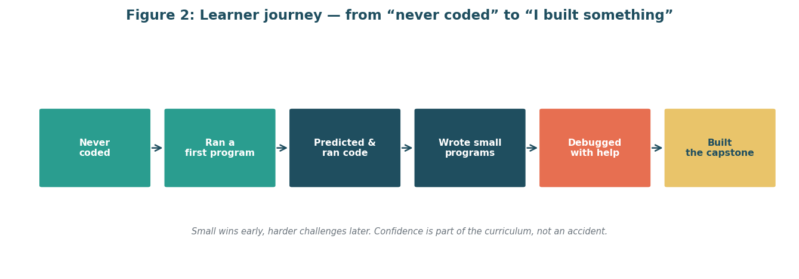

<!-- Improved compatibility of back to top link: See: https://github.com/othneildrew/Best-README-Template/pull/73 -->
<a id="readme-top"></a>
<!--
*** Thanks for checking out the Best-README-Template. If you have a suggestion
*** that would make this better, please fork the repo and create a pull request
*** or simply open an issue with the tag "enhancement".
*** Don't forget to give the project a star!
*** Thanks again! Now go create something AMAZING! :D
-->

<!-- PROJECT SHIELDS -->
<!--
*** I'm using markdown "reference style" links for readability.
*** Reference links are enclosed in brackets [ ] instead of parentheses ( ).
*** See the bottom of this document for the declaration of the reference variables
*** for contributors-url, forks-url, etc. This is an optional, concise syntax you may use.
*** https://www.markdownguide.org/basic-syntax/#reference-style-links
-->
[![Contributors][contributors-shield]][contributors-url]
[![Forks][forks-shield]][forks-url]
[![Stargazers][stars-shield]][stars-url]
[![Issues][issues-shield]][issues-url]
[![Python][python-shield]][python-url]
[![Report][report-shield]][report-url]
[![License][license-shield]][license-url]

<!-- PROJECT LOGO -->
<br />
<div align="center">
  <a href="https://github.com/mishtiiikrishnaa/virtualinternship2">
    
  </a>

<h3 align="center">Week 1 — Project Planning and Scope Definition</h3>

  <p align="center">
    A full project plan for a programming fundamentals module for non-programmers — written for people who have never coded, so every jargon term is explained.
    <br />
    <a href="#usage"><strong>Explore the docs »</strong></a>
    <br />
    <br />
    <a href="reports/Project_Plan_Scope_Definition_Week1.docx">View the Report</a>
    &middot;
    <a href="https://github.com/mishtiiikrishnaa/virtualinternship2/issues/new?labels=bug&template=bug-report---.md">Report Bug</a>
    &middot;
    <a href="https://github.com/mishtiiikrishnaa/virtualinternship2/issues/new?labels=enhancement&template=feature-request---.md">Request Feature</a>
  </p>
</div>

<!-- TABLE OF CONTENTS -->
<details>
  <summary>Table of Contents</summary>
  <ol>
    <li>
      <a href="#about-the-project">About The Project</a>
      <ul>
        <li><a href="#the-module-in-5-lines">The Module in 5 Lines</a></li>
        <li><a href="#built-with">Built With</a></li>
      </ul>
    </li>
    <li>
      <a href="#getting-started">Getting Started</a>
      <ul>
        <li><a href="#prerequisites">Prerequisites</a></li>
        <li><a href="#installation">Installation</a></li>
      </ul>
    </li>
    <li><a href="#usage">Usage</a></li>
    <li><a href="#layout">Layout</a></li>
    <li><a href="#roadmap">Roadmap</a></li>
    <li><a href="#honest-limitations">Honest Limitations</a></li>
    <li><a href="#contributing">Contributing</a></li>
    <li><a href="#license">License</a></li>
    <li><a href="#acknowledgments">Acknowledgments</a></li>
  </ol>
</details>

<!-- ABOUT THE PROJECT -->
## About The Project

[![Curriculum structure — 10 modules building to a capstone][product-screenshot]]

This folder holds the Week 1 project plan for a programming fundamentals module for non-programmers. It is written for people who have never coded, so every jargon term is explained.

The report is reproducible from scripts (not hand-edited after generation), and figures and tests live beside the report they support.

<!-- MODULE SUMMARY -->
### The Module in 5 Lines

Python, in the browser, no installs.

10 modules, 30 teaching hours, for adults or students who have never coded.

Thinks in steps in Modules 1–3, chooses and repeats in 4–5, groups steps in 6, organises data in 7, uses files in 8, reads errors in 9, builds a mini-project in 10.

Worked examples, Parsons problems, pair work, and predict–run–modify tasks throughout.

Short quizzes, exit tickets, small exercises, and a capstone rubric.

<p align="right">(<a href="#readme-top">back to top</a>)</p>

<!-- BUILT WITH -->
### Built With

This section should list any major frameworks/libraries used to bootstrap your project. Leave any add-ons/plugins for the acknowledgments section. Here are a few examples.

* [![Python][Python.js]][Python-url]
* [![python-docx][python-docx.js]][python-docx-url]
* [![matplotlib][matplotlib.js]][matplotlib-url]
* [![pytest][pytest.js]][pytest-url]
* [![LibreOffice][LibreOffice.js]][LibreOffice-url]

<p align="right">(<a href="#readme-top">back to top</a>)</p>

<!-- GETTING STARTED -->
## Getting Started

This is an example of how you may give instructions on setting up your project locally. To get a local copy up and running follow these simple example steps.

### Prerequisites

This is an example of how to list things you need to use the software and how to install them.

* python 3.10 or newer

  ```sh
  python3 --version
  ```

* pip

  ```sh
  pip3 --version
  ```

* git

  ```sh
  git --version
  ```

* libreoffice (optional — only for the PDF preview)

  ```sh
  soffice --version
  ```

### Installation

1. Clone the repo (from the repository root)

   ```sh
   git clone git@github.com:mishtiiikrishnaa/virtualinternship2.git
   cd virtualinternship2
   ```

2. Install Python dependencies

   ```sh
   pip install -r weeks/week1/requirements.txt
   ```

3. Build the figures and the report

   ```sh
   make week1
   ```

4. Run the checks

   ```sh
   make check
   ```

5. Change git remote url to avoid accidental pushes to base project

   ```sh
   git remote set-url origin git@github.com:mishtiiikrishnaa/virtualinternship2.git
   git remote -v # confirm the changes
   ```

<p align="right">(<a href="#readme-top">back to top</a>)</p>

<!-- USAGE EXAMPLES -->
## Usage

Use this space to show useful examples of how a project can be used. Additional screenshots, code examples and demos work well in this space. You may also link to more resources.

* Open `weeks/week1/reports/Project_Plan_Scope_Definition_Week1.docx` in Microsoft Word. Use the table of contents field at the start of the document to jump between sections (right-click → Update Field if the numbers need refreshing).
* Read the PDF preview at `weeks/week1/reports/Project_Plan_Scope_Definition_Week1.pdf` for a quick visual check of the figures and tables.
* For the research notes behind the plan, see `docs/research_register.md`. For assumptions and decisions, see `docs/assumptions_and_decisions.md`. The 275-word submission text is in `docs/submission_text.txt`.

_For more examples, please refer to the [Documentation](#readme-top)_

<p align="right">(<a href="#readme-top">back to top</a>)</p>

<!-- LAYOUT -->
## Layout

```
week1/
  README.md
  requirements.txt
  docs/            research register, assumptions and decisions, submission text
  figures/         six png diagrams
  src/             make_figures.py, build_docx.py
  reports/         the docx (and pdf preview)
  tests/           test_docx.py (pytest)
```

<p align="right">(<a href="#readme-top">back to top</a>)</p>

<!-- ROADMAP -->
## Roadmap

- [x] Week 1: Project planning and scope definition
  - Add CHANGELOG
  - Keep dates honest (planned baseline 5 November 2026)
  - Keep the .docx under 2 MB
- [ ] Week 2: Not started (focus added when announced)
- [ ] Week 3: Not started (focus added when announced)
- [ ] Week 4: Not started (focus added when announced)

See the [open issues](https://github.com/mishtiiikrishnaa/virtualinternship2/issues) for a full list of proposed features (and known issues).

<p align="right">(<a href="#readme-top">back to top</a>)</p>

<!-- HONEST LIMITATIONS -->
## Honest Limitations

* Timeline dates in Section 9 are planned, not done. Baseline is 5 November 2026 (planned), the first working day after the report date. They skip weekends and the 25 November 2026 holiday.
* References are public sources found on 4 November 2026. Where I only saw an abstract I marked the entry to check before citing.
* Effort is 120 planned hours matching the resource table. It is a planning figure, not a quote.
* The .docx TOC is a live Word field. Open in Word and choose Update Field to get page numbers in the TOC itself.

<p align="right">(<a href="#readme-top">back to top</a>)</p>

<!-- CONTRIBUTING -->
## Contributing

Contributions are what make the open source community such an amazing place to learn, inspire, and create. Any contributions you make are **greatly appreciated**.

This is a solo internship repo. If you have a suggestion that would make this better, please fork the repo and create a pull request. You can also simply open an issue with the tag "enhancement". Don't forget to give the project a star! Thanks again!

1. Fork the Project
2. Create your Feature Branch (`git checkout -b feature/AmazingFeature`)
3. Commit your Changes (`git commit -m 'Add some AmazingFeature'`)
4. Push to the Branch (`git push origin feature/AmazingFeature`)
5. Open a Pull Request

<p align="right">(<a href="#readme-top">back to top</a>)</p>

### Top contributors:

<a href="https://github.com/mishtiiikrishnaa/virtualinternship2/graphs/contributors">
  
</a>

<p align="right">(<a href="#readme-top">back to top</a>)</p>

<!-- LICENSE -->
## License

No license file is included in this repository. It is for internship submission and review only. Please ask before reusing the text or figures.

<p align="right">(<a href="#readme-top">back to top</a>)</p>

<!-- ACKNOWLEDGMENTS -->
## Acknowledgments

Use this space to list resources you find helpful and would like to give credit to. I've included a few of my favorites to kick things off!

* [othneildrew/Best-README-Template](https://github.com/othneildrew/Best-README-Template) for the README structure and badges
* [Harvard CS50x](https://cs50.harvard.edu/x/), [Python for Everybody](https://www.py4e.com/), [Automate the Boring Stuff with Python](https://automatetheboringstuff.com/2e/), [Code.org](https://code.org/en-US/curriculum/computer-science-fundamentals) for public beginner course structures
* [MIT Teaching and Learning Lab](https://tll.mit.edu/teaching-resources/how-people-learn/worked-examples/) and [Raspberry Pi Foundation](https://www.raspberrypi.org/blog/supporting-learners-with-programming-tasks-through-ai-generated-parsons-problems/) for worked examples and Parsons problems
* [Shields.io](https://shields.io) for the badges

This repository was drafted with AI assistance and reviewed by me.

Thanks for reading. Mishti.

<p align="right">(<a href="#readme-top">back to top</a>)</p>

<!-- MARKDOWN LINKS & IMAGES -->
<!-- https://www.markdownguide.org/basic-syntax/#reference-style-links -->
[contributors-shield]: https://img.shields.io/github/contributors/mishtiiikrishnaa/virtualinternship2.svg?style=for-the-badge
[contributors-url]: https://github.com/mishtiiikrishnaa/virtualinternship2/graphs/contributors
[forks-shield]: https://img.shields.io/github/forks/mishtiiikrishnaa/virtualinternship2.svg?style=for-the-badge
[forks-url]: https://github.com/mishtiiikrishnaa/virtualinternship2/network/members
[stars-shield]: https://img.shields.io/github/stars/mishtiiikrishnaa/virtualinternship2.svg?style=for-the-badge
[stars-url]: https://github.com/mishtiiikrishnaa/virtualinternship2/stargazers
[issues-shield]: https://img.shields.io/github/issues/mishtiiikrishnaa/virtualinternship2.svg?style=for-the-badge
[issues-url]: https://github.com/mishtiiikrishnaa/virtualinternship2/issues
[license-shield]: https://img.shields.io/badge/license-none-red.svg?style=for-the-badge
[license-url]: #license
[python-shield]: https://img.shields.io/badge/python-3.13-blue.svg?style=for-the-badge
[python-url]: https://www.python.org/
[report-shield]: https://img.shields.io/badge/report-~6%2C734%20words%20%7C%20348%20KB%20%7C%20docx-orange.svg?style=for-the-badge
[report-url]: reports/Project_Plan_Scope_Definition_Week1.docx
[product-screenshot]: figures/fig1_curriculum_structure.png
<!-- Shields.io badges. You can a comprehensive list with many more badges at: https://github.com/inttter/md-badges -->
[Python.js]: https://img.shields.io/badge/python-3.13-3776AB?style=for-the-badge&logo=python&logoColor=white
[Python-url]: https://www.python.org/
[python-docx.js]: https://img.shields.io/badge/python--docx-4B0082?style=for-the-badge
[python-docx-url]: https://python-docx.readthedocs.io/
[matplotlib.js]: https://img.shields.io/badge/matplotlib-11557f?style=for-the-badge
[matplotlib-url]: https://matplotlib.org/
[pytest.js]: https://img.shields.io/badge/pytest-0A9EDC?style=for-the-badge&logo=pytest&logoColor=white
[pytest-url]: https://docs.pytest.org/
[LibreOffice.js]: https://img.shields.io/badge/libreoffice-18A303?style=for-the-badge&logo=libreoffice&logoColor=white
[LibreOffice-url]: https://www.libreoffice.org/
